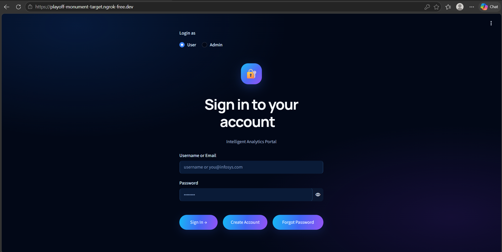
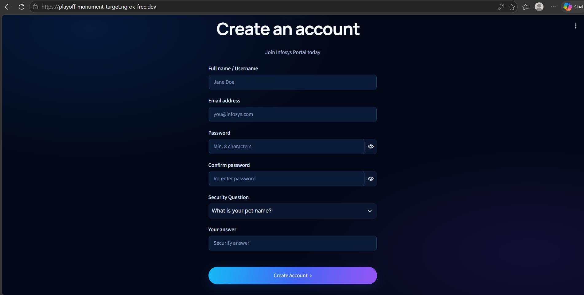
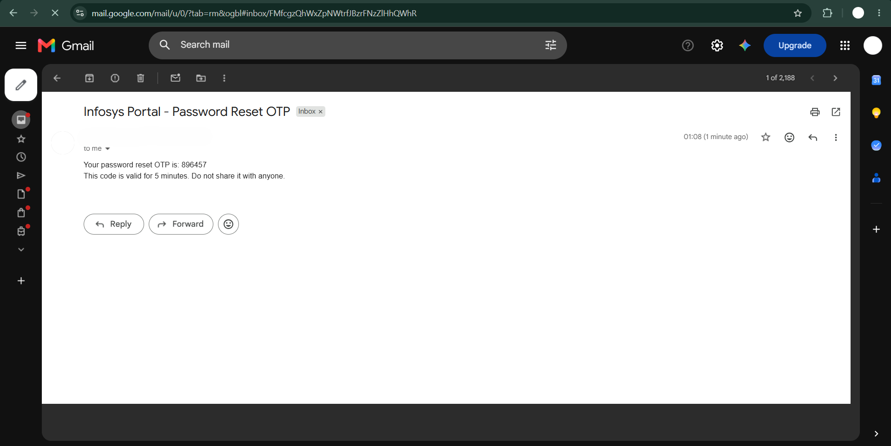
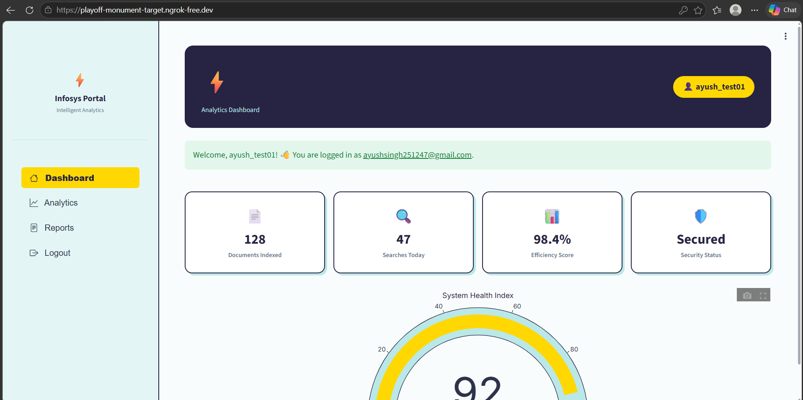
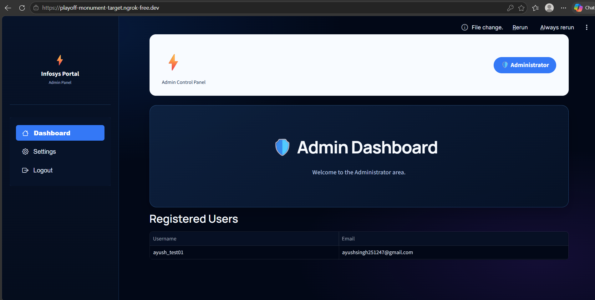

# Infosys Springboard Internship 7.0 – Milestone 1

## User Authentication Module

This is my Milestone 1 project for the Infosys Springboard Internship 7.0 (Batch 4). The aim of this milestone is to build a small web application where users can create an account, sign in, and recover their password if they forget it.

I used Streamlit to make the interface and Google Colab to run the notebook. The notebook creates the Streamlit app and starts it with an ngrok link so it can be opened in a browser.

## What the project does

- Lets a new user create an account with a username, email, password, and security question.
- Provides a login page for users and a separate admin login option.
- Uses bcrypt to hash passwords and security answers before saving them.
- Uses JWT to create a session token after a successful login.
- Provides two password-recovery options: security question and email OTP.
- Sends password-reset OTPs using Gmail SMTP. The OTP is intended to expire after five minutes.
- Stores registered account details in a local SQLite database created by the app.
- Shows dashboard pages with navigation options and a logout action.
- Uses a dark Streamlit layout with `streamlit-option-menu` and Plotly for parts of the interface.

Please test the different flows in the running app before marking each requirement as complete. The screenshots section below is for screenshots captured from the actual running project.

## Tools and libraries

- **Python** – application logic
- **Streamlit** – web interface
- **SQLite** – user records
- **bcrypt** – password and security-answer hashing
- **PyJWT** – JSON Web Tokens for sessions
- **smtplib / Gmail SMTP** – sending password-reset OTP emails
- **pyngrok** – making the Colab-hosted app accessible through a temporary link
- **Google Colab Secrets** – storing configuration values securely
- **Plotly** – charts used in the interface
- **streamlit-option-menu** – navigation menu

## Files in this folder

```text
Milestone1/
├── README.md
├── Infosys_Milestone1_Authentication.ipynb
├── requirements.txt
└── screenshots/
    └── .gitkeep
```

The notebook writes the Streamlit app file (`app.py`) and its Streamlit configuration when the relevant notebook cells run. The SQLite database is created when the app starts and users register.

## How to run the project

This notebook is set up for **Google Colab**. It uses Colab Secrets and notebook shell commands, so it will not run locally without changes.

### 1. Open the notebook

1. Download `Infosys_Milestone1_Authentication.ipynb` from this folder, or open it from the repository in Google Colab.
2. Connect to a Colab runtime.
3. Open the **Secrets** panel using the key icon in the left sidebar.

### 2. Add the required secrets

Create the following secrets in Colab and switch notebook access on for each one.

| Secret name | What it is for |
|---|---|
| `NGROK_AUTHTOKEN` | Your personal ngrok authtoken |
| `JWT_SECRET` | A long, random string used to sign JWTs |
| `EMAIL_ADDRESS` | The Gmail address that sends password-reset emails |
| `EMAIL_PASSWORD` | A Gmail App Password, not your normal Gmail password |
| `ADMIN_PASSWORD` | The password used for the admin login |

For Gmail, turn on 2-Step Verification in your Google Account before creating an App Password. Keep these values private. Do not put their real values in this README, notebook, screenshots, or any public repository.

### 3. Run the notebook

1. Run the notebook cells from the beginning, in order.
2. Make sure the required secrets are available and notebook access is enabled.
3. The notebook installs the libraries, writes the app code, and starts Streamlit.
4. When the launch cell prints an ngrok URL, open that URL in your browser.
5. Try creating a test account and check the login, password recovery, dashboard, and logout flows.
6. Test the admin login separately and check what appears in the admin dashboard.

The ngrok link is temporary. It can change after the Colab runtime restarts, so it should not be saved in the repository or README.

### Running locally

The notebook uses `google.colab.userdata`, Colab shell commands, and ngrok setup. For that reason, `pip install -r requirements.txt` by itself is not enough to run the complete project locally. The Colab-specific launch code and secret loading would need to be adapted first.

## Validation and security checks

The milestone instructions ask for the following checks. Please confirm each one in the app before treating it as finished:

- Required fields should not be left blank.
- Email addresses should follow the format required by the milestone.
- Passwords should be at least eight characters and include an uppercase letter, a lowercase letter, a number, and a special character.
- The confirm-password field should match the password exactly.
- A username or email that is already registered should be rejected.
- A failed user login should show a general error rather than saying which credential was incorrect.
- The security-question answer and email OTP recovery routes should both work.
- A reset OTP should expire after five minutes.
- The dashboard should require a valid login session, and logout should clear the session.
- The admin view should show registered usernames/emails only, not password data.

Passwords and security answers are hashed in the app. Still, this is an internship learning project and should not be used as a production authentication service without a security review.

## Screenshots

Take these screenshots from your own running application and upload the image files to the `screenshots` folder. The links below will display the images once those files have been added. Do not use screenshots that expose email passwords, secret values, OTPs, or private user data.

### 1. Login page



### 2. Signup page



### 3. Forgot password – security question


### 4. Forgot password – OTP option


### 5. OTP email



### 6. User dashboard



### 7. Admin dashboard




