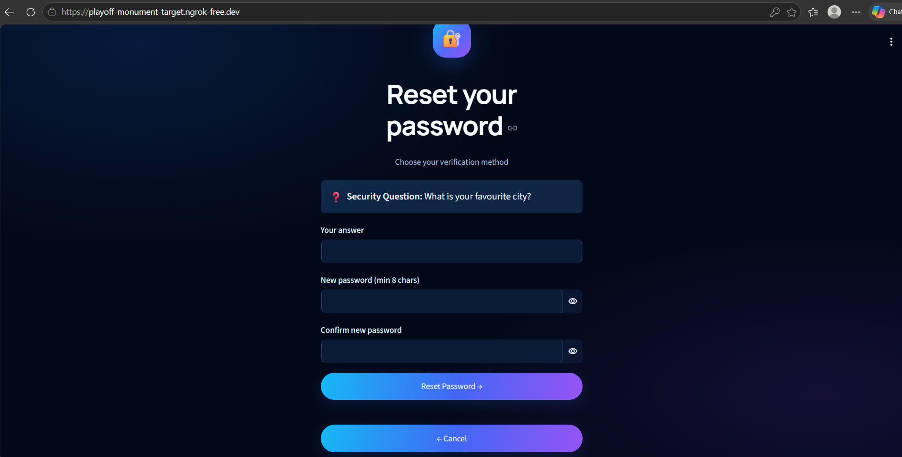
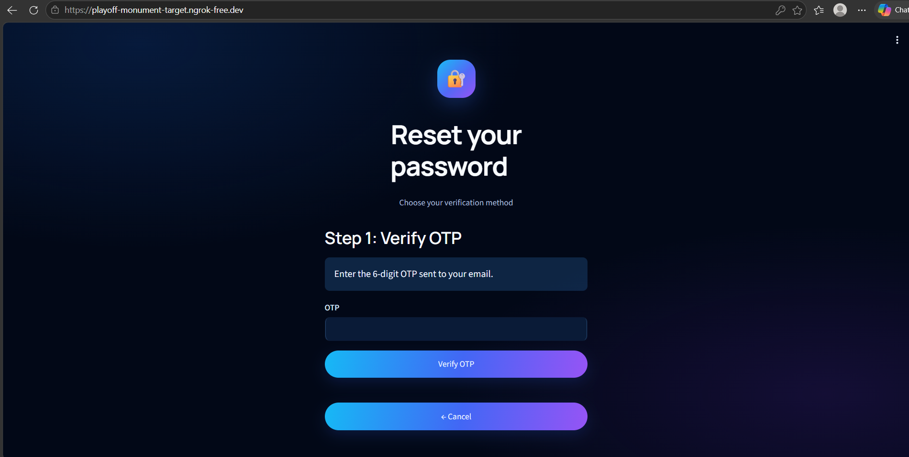

# Infosys Springboard Internship 7.0 — Batch 4, Milestone 1

## User Authentication Module

This project implements a user-authentication application using **Streamlit**. It includes account registration, login, password recovery, JWT-based session handling, and separate user and administrator dashboards. The app is designed to run in Google Colab and expose the Streamlit interface through an **ngrok** tunnel.

## Features

- **Login:** Sign in using a username or email and password. A successful login creates a JWT session; invalid credentials produce a general login error.
- **Signup:** Register with a username, email, password, password confirmation, security question, and security answer. Required fields and duplicate accounts are checked.
- **Input validation:** Checks required fields, email format, password strength, and password confirmation.
- **Password recovery:** Reset a password using either the saved security question and answer or a one-time password (OTP) sent to the registered email address.
- **JWT session management:** Keeps the login token in Streamlit session state and validates it before showing the user dashboard.
- **User dashboard:** Displays a welcome message for the signed-in user and provides a logout option.
- **Admin dashboard:** Provides a separate administrator login and displays registered usernames and email addresses without showing password data.
- **Database:** Uses SQLite for account data; passwords and security answers are stored as hashes.
- **Colab and public access:** Uses Google Colab Secrets for sensitive configuration and ngrok to expose the Streamlit app.

## Technology Stack

- Python
- Streamlit
- SQLite
- JSON Web Tokens (JWT)
- bcrypt password hashing
- Gmail SMTP for OTP email delivery
- Google Colab Secrets
- pyngrok / ngrok
- Plotly and streamlit-option-menu (where used by the notebook UI)

## Configuration and secrets

Configure these secrets in the **Secrets** panel in Google Colab and enable notebook access for each one used by the notebook:

| Secret name | Purpose |
|---|---|
| `JWT_SECRET` | Secret key used to sign JWT session tokens |
| `NGROK_AUTHTOKEN` | ngrok authentication token used to create the public tunnel |
| `EMAIL_ADDRESS` | Gmail address used to send OTP messages |
| `EMAIL_PASSWORD` | Gmail App Password used for SMTP authentication |

Do not put real tokens, passwords, or other private credentials in the notebook or this repository. Do not commit database files containing real user data.

The administrator credentials are configured separately from ordinary user signup. Follow the implementation in the notebook and keep any administrator password private.

## How to run in Google Colab

1. Open `Infosys_Milestone1_Authentication.ipynb` in Google Colab.
2. Add and configure the Colab Secrets listed above. For Gmail OTP, use a Gmail App Password rather than your normal Google account password.
3. Run the notebook cells from top to bottom. Allow any dependency-installation cells to finish.
4. Start the Streamlit application on port `8501` and run the ngrok setup cell.
5. Open the public URL printed by ngrok to use the application.
6. Test signup, login, both password-recovery methods, the user dashboard, logout, and the separate admin login.

If ngrok reports that the endpoint is already online, stop the previous tunnel/process or reuse the active tunnel instead of creating a second tunnel with the same endpoint.

## Validation rules

The application validates required form fields, email format, password strength, and password confirmation. The password rule requires at least eight characters, including uppercase and lowercase letters, a number, and a special character. Password recovery applies the same password validation.

## Screenshots

Add screenshots to a `screenshots/` folder and update the filenames below to match the images you include.

| Screen / flow | Screenshot |
|---|---|
| Login |  |
| Signup |  |
| Forgot password — security question |  |
| Forgot password — email OTP |  |
| OTP email |  |
| User dashboard |  |
| Admin dashboard |  |

## Project file

- `Infosys_Milestone1_Authentication.ipynb` — notebook containing the application implementation and run setup.

